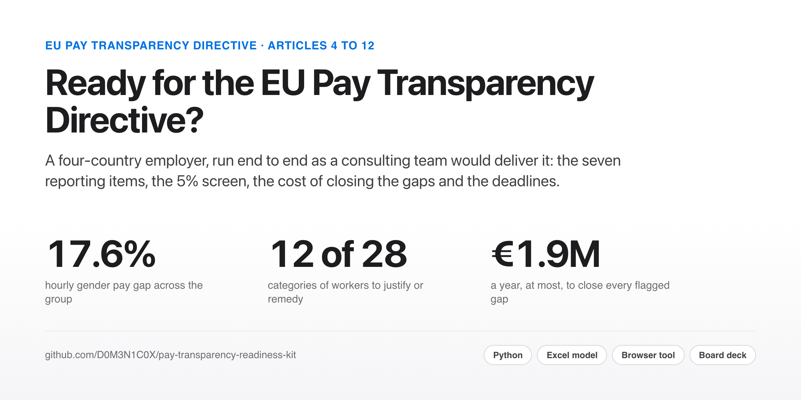
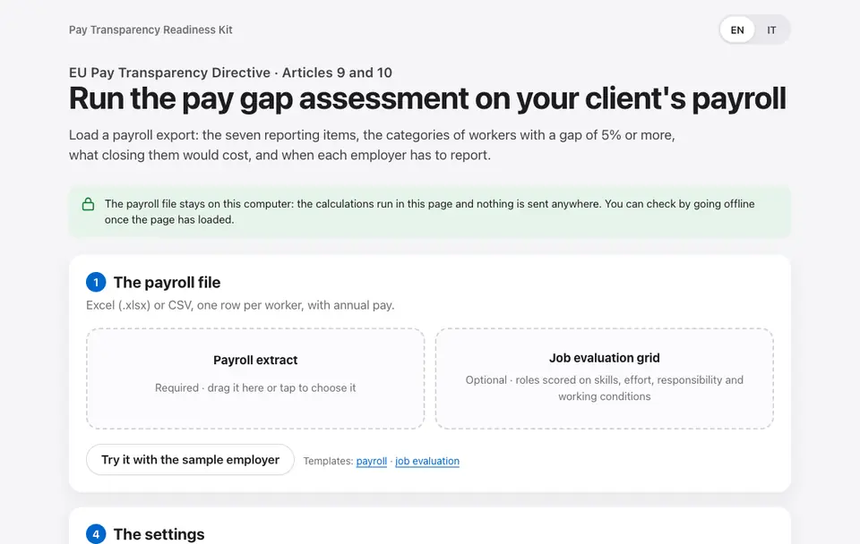
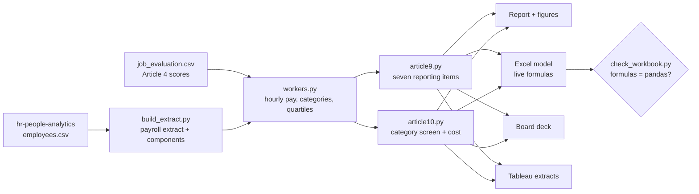

<picture>
  <source media="(prefers-color-scheme: dark)" srcset="site-assets/cover-dark.png">
  
</picture>

<p align="center">
  <a href="https://d0m3n1c0x.github.io/pay-transparency-readiness-kit/tool/"><b>Run it on your own payroll</b></a> ·
  <a href="https://d0m3n1c0x.github.io/pay-transparency-readiness-kit/">Read the report</a> ·
  <a href="https://d0m3n1c0x.github.io/pay-transparency-readiness-kit/board_briefing.pdf">Board briefing (PDF)</a> ·
  <a href="https://github.com/D0M3N1C0X/pay-transparency-readiness-kit/raw/main/deliverables/pay_transparency_model.xlsx">Excel model</a>
</p>

<p align="center">
  <a href="https://github.com/D0M3N1C0X/pay-transparency-readiness-kit/actions/workflows/ci.yml"></a>
  
  
</p>

## Why this matters

From **7 June 2027**, every employer in the EU with 150 or more workers has to report its gender pay gap, and
any category of workers with a gap of **5% or more** has to be justified on gender-neutral grounds or fixed within
six months, or a joint pay assessment with workers' representatives follows. Most HR teams have never computed
these figures the way the Directive defines them.

This kit answers the four questions a board will ask, for an employer with entities in Italy, Poland, Germany and
Spain, **as a reward consulting team would deliver it**: when do we report, what will the numbers say, where are the
gaps and why, and what would closing them cost.

> **Synthetic data, not legal advice.** The organisation is the one analysed in
> [hr-people-analytics](https://github.com/D0M3N1C0X/hr-people-analytics); pay components and one discriminatory
> mechanism were added here and are [declared openly](data/README.md#what-is-planted-stated-openly). Legal status as
> of 16 September 2026, transposition rechecked on 23 October 2026, every source in the
> [verification register](docs/verification.md).

## The answer, for the board

| | |
|---|---|
| **All four employers report every year from 7 June 2027.** Italy has transposed the Directive (D.Lgs. 96/2026); Poland only in part; Germany and Spain not yet. | **The hourly gender pay gap is 17.6%** across the group, from 14.5% in Munich to 21.5% in Barcelona. |
| **Base pay alone gives 15.4%** - the same figure hr-people-analytics found. Bonus, commission and allowances add 2.2 points. | **12 of 28 categories of workers** are at 5% or more: each needs a gender-neutral justification or a remedy by **7 December 2027**, or a joint pay assessment follows. |
| In Sales, commission is **12.6% of base pay for women and 15.1% for men** under identical rules: territories are allocated unequally. | Closing every flagged gap outright would cost **at most €1.9 million a year**. Of 14 obligations, **1 is in place, 6 partly, 7 missing**. |



## Run it on a client's payroll

The same assessment runs in the browser on any payroll export, Excel or CSV. Columns are matched by name, gender
codes are confirmed by the user, roles are scored on the four Article 4 criteria (or categories come from the file),
and the result downloads as an Excel workbook with, for every flag, the justification written on the page and
columns for an owner and a due date.
**The file never leaves the computer.**

<p align="center"><a href="https://d0m3n1c0x.github.io/pay-transparency-readiness-kit/tool/"></a></p>

## What you get

| Deliverable | For | What is in it |
|---|---|---|
| [`pay_transparency_model.xlsx`](deliverables/pay_transparency_model.xlsx) | the client team | Ten sheets: summary, the seven Article 9 items per employer, the Article 10 screen with space for justifications, obligations and deadlines, readiness checklist, job evaluation, payroll, settings, and a reconciliation sheet. **Every figure is a live formula**: change a salary, a score or a threshold and the model recalculates. |
| [Browser tool](https://d0m3n1c0x.github.io/pay-transparency-readiness-kit/tool/) | the consultant, on the client's own file | The assessment on any payroll export, Excel or CSV, in the page: columns matched by name, roles scored on the four Article 4 criteria (or categories taken from the file), the seven items per employer, the category screen with a justification per flag, the cost ceiling, the reporting dates per country. Downloads an Excel workbook; **the file never leaves the computer**. English and Italian. |
| [`board_briefing.pptx`](deliverables/board_briefing.pptx) | the board | Ten slides, answer first, native charts, three decisions to take. |
| [`readiness_report.md`](reports/readiness_report.md) | HR and Legal | The written read-out: obligations, the seven items, where the gap comes from, flagged categories with their main driver and cost, a 90-day plan. |
| [`tableau/`](tableau/) | a live dashboard | Tidy extracts and a build sheet for Tableau Public. |
| [`docs/method.md`](docs/method.md) · [`docs/verification.md`](docs/verification.md) | reviewers | Every choice the Directive leaves open, and the source and status of every legal statement. |
| [`docs/catalogue.md`](docs/catalogue.md) | reviewers | One card per reporting item: result per employer, the workbook formula, the choice made, what a statutory report adds. |
| [`docs/engagement-playbook.md`](docs/engagement-playbook.md) | the client's HR and reward team | How the assessment runs, step by step: who does what, what each step hands over, the gate before the next. |
| [`docs/architecture.md`](docs/architecture.md) · [`docs/roadmap.md`](docs/roadmap.md) · [`CHANGELOG.md`](CHANGELOG.md) | whoever maintains or extends it | How the engines stay equal and how to run it on real data; what comes next; what changed. |

## The judgement calls

Where the Directive leaves room, the kit makes a choice and says why. The ones that change the answer:

- **Pay level means hourly and annual pay.** Items (a) and (c) are reported both ways, because Article 3 defines pay
  level as both; a part-time-heavy workforce can look fair on one and not on the other.
- **A category is flagged in either direction**, on hourly or annual pay. A gap against men is still a gap.
- **Categories come from a gender-neutral job evaluation** on skills, effort, responsibility and working conditions,
  with a rationale for every score. In Italy they should start from the collective agreement, which D.Lgs. 96/2026
  presumes compliant.
- **The cost is a ceiling, not a budget.** Lifting the lower-paid group's average to the other's, before any part of
  the gap is justified: the number a CFO needs before the justifications come in.
- **Small categories are protected.** Below five women or men, averages are kept back (Article 12(3) leaves the
  threshold to Member States).
- **This is a dry run** on a 30 June 2026 snapshot; the statutory report covers pay paid in the previous calendar
  year.

The full reasoning is in [docs/method.md](docs/method.md); how an engagement runs, week by week, in the
[engagement playbook](docs/engagement-playbook.md).

## Built to be checked

| | |
|---|---|
| **Three engines, one answer** | pandas, the Excel model's live formulas (reconciled on 460 checks, recalculated by LibreOffice in CI) and the browser tool (checked against pandas on 3,177 values) |
| **Every legal statement sourced** | a [verification register](docs/verification.md) with the source, its status and the date each one was read |
| **Reproducible** | one command rebuilds every output; CI fails if a rebuilt file differs from the committed one |
| **Documented like a deliverable** | a [catalogue](docs/catalogue.md) of the reporting items, a [data dictionary](data/README.md) kept complete by a test, an [architecture](docs/architecture.md) note, a [roadmap](docs/roadmap.md) and a [changelog](CHANGELOG.md) |

<details>
<summary><b>For engineers: how it fits together, how to run it</b></summary>



```bash
python3 -m venv .venv && . .venv/bin/activate
pip install -r requirements.txt
python src/run_all.py        # about 10 seconds
pip install -r requirements-dev.txt
pytest                       # includes a sample workbook recalculated in pure Python
ruff check .
node tests/js/check_engine.mjs   # the browser engine against pandas
```

The reconciliation check, the LibreOffice recalculation and the byte-stable workbook come from
[excel-twin](https://github.com/D0M3N1C0X/excel-twin), a small library shared by the portfolio.

```
├── data/
│   ├── source/employees.csv     the organisation from hr-people-analytics (checksum pinned)
│   ├── payroll_extract.csv      3,443 workers with four pay components
│   ├── job_evaluation.csv       36 roles scored on the Article 4(4) criteria
│   ├── transposition.csv        national status, with sources
│   └── readiness_checklist.csv  14 obligations from Articles 4 to 12
├── src/
│   ├── config.py                every assumption in one place
│   ├── build_extract.py         the payroll extract (standard library, byte-stable)
│   ├── workers.py               hourly pay, categories, quartile bands
│   ├── article9.py              the seven reporting items
│   ├── article10.py             category gaps, the 5% screen, remediation cost
│   ├── obligations.py           size bands, deadlines, readiness
│   ├── build_workbook.py        the Excel model and its reconciliation sheet
│   ├── check_workbook.py        proves the formulas reproduce pandas
│   ├── recalc_libreoffice.py    recalculates the workbook headless, for CI
│   ├── build_deck.py            the board briefing
│   ├── build_report.py          the written read-out and its figures
│   ├── charts.py                three SVG charts, validated palette, light and dark
│   ├── build_tableau.py         extracts for Tableau Public
│   └── run_all.py               the whole pipeline
├── deliverables/                the workbook and the deck
├── reports/                     the read-out, its HTML page and figures
├── tableau/                     extracts and the dashboard build sheet
├── docs/                        method, verification register, catalogue, playbook, architecture, roadmap
└── tests/
```

</details>

## About

Built by **Domenico Perroni**: HR advisory for the Italian market, people analytics and reward, based in Kraków.
[GitHub](https://github.com/D0M3N1C0X) · [LinkedIn](https://www.linkedin.com/in/domenico-perroni) · [Portfolio](https://d0m3n1c0x.github.io/)

**More from the same portfolio**

- [where-pay-transparency-bites](https://github.com/D0M3N1C0X/where-pay-transparency-bites) — Eurostat data for all 27 Member States, analysed in R: the published gender pay gap understates the gap inside sectors, most of all where it looks small; [article](https://d0m3n1c0x.github.io/where-pay-transparency-bites/), [dashboard](https://d0m3n1c0x.github.io/where-pay-transparency-bites/dashboard/) and [working paper](https://d0m3n1c0x.github.io/where-pay-transparency-bites/paper.pdf)
- [workforce-cost-model](https://github.com/D0M3N1C0X/workforce-cost-model) — **puts this kit's remediation cost into next year's budget**: Italian and Polish employer costs, the FY2026 budget variance and FY2027 scenarios in a live Excel model reconciled with pandas, with the [memo online](https://d0m3n1c0x.github.io/workforce-cost-model/)
- [equal-value-pay-ranges](https://github.com/D0M3N1C0X/equal-value-pay-ranges) — **turns this kit's job evaluation into a pay structure**: one range per grade and country, priced on Eurostat market data, with the range to publish for every vacancy (Article 5) in a [pay range finder](https://d0m3n1c0x.github.io/equal-value-pay-ranges/ads.html)
- [hr-people-analytics](https://github.com/D0M3N1C0X/hr-people-analytics) — attrition drivers, EU pay-transparency exposure and HR service-desk performance on a synthetic 4,000-employee organisation, with the [report online](https://d0m3n1c0x.github.io/hr-people-analytics/)
- [engagement-survey-analytics](https://github.com/D0M3N1C0X/engagement-survey-analytics) — an employee engagement survey analysed end to end, with a [live dashboard](https://d0m3n1c0x.github.io/engagement-survey-analytics/) you can filter in the browser
- [job-search-agent](https://github.com/D0M3N1C0X/job-search-agent) — a job search run as a pipeline: public ATS board APIs, explainable fit scoring, funnel analytics
- [pompei-stratificata](https://github.com/D0M3N1C0X/pompei-stratificata) — Pompeii and Herculaneum from AD 79 to today, a [walkable model](https://d0m3n1c0x.github.io/pompei-stratificata/) with a sourced documentary dossier, in six languages

MIT licensed. Reuse anything here.
