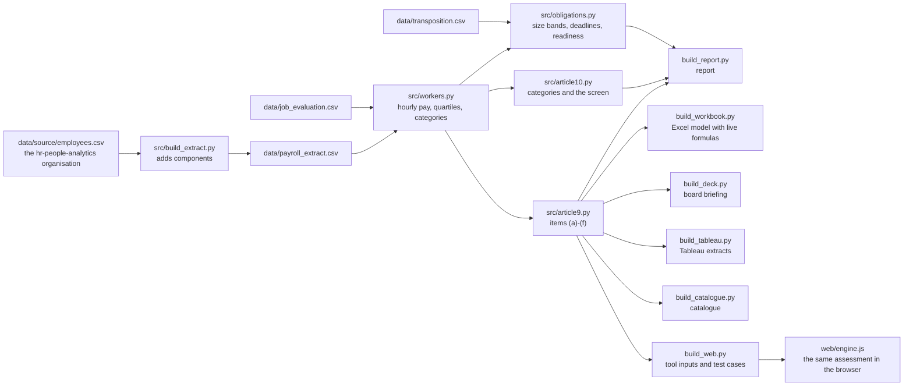

# Architecture

One payroll extract in, five deliverables out, every figure computed twice; the browser tool computes the
assessment a third time, on any client's file. This page shows the flow, how the three engines are kept equal,
and how to run the kit on a real client's data.

## The flow

`python src/run_all.py` rebuilds everything in order. Settings a client would change (hours, thresholds, factor
weights, band limits) live in `src/config.py`.

## How the engines are kept equal

| Check | Where | What it guarantees |
|---|---|---|
| Excel against pandas | Reconciliation sheet, `src/check_workbook.py` | 460 figures equal in both engines: in pure Python with [excel-twin](https://github.com/D0M3N1C0X/excel-twin) in the tests, recalculated by LibreOffice in CI |
| Browser against pandas | `tests/js/check_engine.mjs` | 3,170 values equal on the sample employer and six random variants (a seven-worker employer, small and one-sex categories, every size band, changed pay and hours) |
| Rebuilt files | CI, `src/deterministic.py` | Rebuilding from scratch gives the same text outputs and workbooks with the same content |
| Known structure | `tests/test_pipeline.py`, `tests/test_articles.py` | The planted commission effect is there; the base-pay gap of the source organisation is reproduced; each Directive rule behaves as written |
| README figures | `tests/test_readme.py` | Every figure the README quotes is the one the code produces today |
| Documents | `tests/test_docs.py` | Every data column is documented; the catalogue is current |
| Style and types | CI, `ruff check .` | Rules in `pyproject.toml`; every function in `src/` declares what it returns |

## Running it on a real client

1. Replace `data/payroll_extract.csv` with the client's extract, in the same columns
   ([data/README.md](../data/README.md)); map each pay code to base pay or to one of the components.
2. Replace `data/job_evaluation.csv` with the client's scored roles, and set the bands in `src/config.py`.
3. Update `data/transposition.csv` from the sources in [verification.md](verification.md), with the date read.
4. Run `python src/run_all.py`, then `pytest`. Tests that assert the synthetic organisation's own figures will
   fail by design: replace them with the client's control totals from payroll.

Real data never goes into this repository: work in a private copy.

**Or, without Python:** open the [browser tool](https://d0m3n1c0x.github.io/pay-transparency-readiness-kit/tool/) on the client's computer and load the extract there. It
reads Excel or CSV in the page, matches the columns by name, and the file is never uploaded. The page loads no
script from another site and has no visit counter; `tests/test_web.py` keeps it that way.
