# Pay transparency readiness: where the organisation stands before its first report

**Scope:** four employers - IT · Milan, PL · Kraków, DE · Munich, ES · Barcelona - with 3,443 workers active on 30 June 2026
**Method:** Article 9 reporting items and the Article 10 screen, computed twice - in pandas and in a live Excel model - and reconciled figure by figure
**Data:** synthetic, built on the organisation analysed in [hr-people-analytics](https://github.com/D0M3N1C0X/hr-people-analytics)

> This is a dry run, not a statutory report. It uses annualised pay of the workers present at the snapshot; the real report covers pay in the previous calendar year, under rules each Member State sets in its own transposition.

## The answer

- **Every employer reports every year, starting 7 June 2027.** All four have 250 workers or more, so the first report covers pay in 2026 (Article 9(2)).
- **The gender pay gap on hourly pay is 17.6% across the group**, from 14.5% in DE · Munich to 21.5% in ES · Barcelona. On base pay alone it is 15.4% - the figure hr-people-analytics reports - so bonuses, commission and allowances add 2.2 points.
- **12 of 28 categories of workers show a difference of 5% or more.** Each needs an objective, gender-neutral justification or a remedy within six months of the report (7 December 2027); otherwise a joint pay assessment with workers' representatives follows (Article 10).
- **Closing those gaps outright would cost at most €1.9 million a year**, before any part of them is justified.
- **The organisation is not ready yet:** of 14 obligations, 1 is in place, 6 are partly in place and 7 are missing - pay ranges in vacancies, published progression criteria and a route for workers' information requests among them.
- **Italy measures the gap on fixed pay, and the Milan figures change.** The decree counts only fixed and continuing pay (livello retributivo): the Milan gap is 18.0% on that measure against 19.7% on total pay. The same categories are flagged; what each one has to justify is not the same (section 5).
- **The law is settled in one country of four.** Legislative Decree No. 96 of 7 May 2026 transposes the Directive in Italy; Poland has transposed the recruitment rules only, and Germany and Spain have not finished.

## 1. What each employer owes, and when

| Employer | Workers | Reporting | First report | Remedy by | Transposition |
|---|---:|---|---|---|---|
| IT · Milan | 1,053 | Every year | 7 Jun 2027 | 7 Dec 2027 | Transposed |
| PL · Kraków | 1,156 | Every year | 7 Jun 2027 | 7 Dec 2027 | Partly transposed |
| DE · Munich | 741 | Every year | 7 Jun 2027 | 7 Dec 2027 | Not transposed |
| ES · Barcelona | 493 | Every year | 7 Jun 2027 | 7 Dec 2027 | Draft |

*Remedy by: six months after the first report, the latest date to justify or close a category gap before a joint pay assessment is due. National status as checked on 24 October 2026; sources in [docs/verification.md](../docs/verification.md).*

For Italy, applying a national collective agreement signed by the unions comparatively most representative at national level is presumed to comply, classification included, unless individual discriminatory pay treatment is shown (D.lgs. 96/2026, art. 4(1)); the agreement's levels are the reference for comparing work of equal value; an employer's own job evaluation may complement them if its criteria are objective and gender-neutral (art. 4(4)). So the categories of workers should start from the agreement's levels and use job evaluation to refine them, not replace them. The categories in this dry run come from job evaluation alone, because the synthetic organisation has no collective agreement.

## 2. The seven reporting items

| Item | IT | PL | DE | ES | Group |
|---|---:|---:|---:|---:|---:|
| Workers at the snapshot | 1,053 | 1,156 | 741 | 493 | 3,443 |
| Women | 523 | 578 | 363 | 253 | 1,717 |
| Men | 530 | 578 | 378 | 240 | 1,726 |
| (a) Gender pay gap, mean hourly pay | 19.7% | 15.2% | 14.5% | 21.5% | 17.6% |
| (a) Gender pay gap, mean annual pay | 20.4% | 15.1% | 15.0% | 21.6% | 17.9% |
| (b) Gap in complementary or variable components, mean | 35.5% | 21.0% | 25.9% | 46.3% | 31.1% |
| (c) Median gender pay gap, hourly pay | 16.9% | 12.5% | 11.3% | 18.9% | 15.6% |
| (c) Median gender pay gap, annual pay | 19.7% | 13.7% | 13.2% | 19.4% | 16.7% |
| (d) Median gap in complementary or variable components | 26.0% | 15.7% | 16.2% | 42.7% | 24.6% |
| (e) Women receiving complementary or variable components | 56.0% | 55.5% | 54.5% | 54.9% | 55.4% |
| (e) Men receiving complementary or variable components | 62.1% | 64.2% | 63.5% | 65.8% | 63.6% |
| (f) Women in quartile pay band 1 (lowest) | 62.9% | 58.8% | 54.3% | 66.1% | 60.1% |
| (f) Women in quartile pay band 4 (highest) | 31.6% | 36.0% | 37.3% | 30.1% | 34.1% |
| Context: gap on base pay alone, mean hourly | 17.5% | 13.6% | 12.6% | 17.7% | 15.4% |

*Gaps are men's pay level minus women's, as a share of men's (Article 3(1)(c)); positive means women are paid less. Items (b) and (d) are computed among workers who receive any component. The middle quartile bands and the men's shares are in the workbook. The group column is a management view, not a statutory figure.*

The median gap sits below the mean everywhere, which says the gap is concentrated at the top of the pay distribution. The quartile bands show why: women are 60% of the lowest band and 34% of the highest.

## 3. Bonus, commission and allowances widen the gap

Among workers who receive any component, women's average is 31.1% below men's (median 24.6%), and fewer women receive one at all: 55% against 64%. Two mechanisms produce most of it:

- **Eligibility follows seniority.** Bonus starts at level L3 and car allowances at L5, while the share of women falls from 57% at L1 to 30% at L6. That part is structural and shows up again in the quartile bands.
- **Commission follows territory.** In Sales, commission averages 12.6% of base pay for women and 15.1% for men. Commission rules are the same for everyone; the territories are not. The generator allocates women territories with lower sales potential - an effect planted on purpose and stated in [data/README.md](../data/README.md), because indirect discrimination through allocation is exactly what an Article 10 assessment should surface.

## 4. Categories of workers: where a justification is needed

Categories come from a gender-neutral job evaluation: every role is scored 1-5 on skills, effort, responsibility and working conditions (Article 4(4)), and roles with similar points form a category, whatever their department. That is how a customer service team lead and a software engineer can do work of equal value - and why a category can mix functions the market pays very differently.

| Employer | Category | Women / men | Hourly gap | Annual gap | Main driver | Cost to close, upper bound |
|---|---|---:|---:|---:|---|---:|
| IT · Milan | Cat B | 147 / 106 | 7.4% | 8.4% | Base pay (7.9 of 7.4 pts) | €331,912 |
| PL · Kraków | Cat D | 125 / 133 | 5.7% | 6.1% | Base pay (5.9 of 5.7 pts) | €262,744 |
| DE · Munich | Cat E | 47 / 65 | 6.0% | 6.3% | Base pay (5.9 of 6.0 pts) | €254,265 |
| PL · Kraków | Cat F | 37 / 56 | 8.0% | 7.0% | Base pay (6.3 of 8.0 pts) | €222,454 |
| PL · Kraków | Cat E | 49 / 87 | 7.9% | 7.5% | Base pay (6.8 of 7.9 pts) | €188,889 |
| ES · Barcelona | Cat D | 56 / 52 | 6.9% | 7.1% | Base pay (4.8 of 6.9 pts) | €173,333 |
| ES · Barcelona | Cat F | 5 / 24 | -5.2% | -7.1% | Base pay (-5.7 of -5.2 pts) | €107,053 |
| ES · Barcelona | Cat B | 64 / 48 | 5.3% | 5.5% | Base pay (5.2 of 5.3 pts) | €97,880 |
| IT · Milan | Cat G | 7 / 20 | 10.5% | 10.5% | Components (5.4 of 10.5 pts) | €95,319 |
| IT · Milan | Cat A | 72 / 55 | 4.1% | 5.4% | Hours worked: flagged on annual pay only | €85,246 |
| ES · Barcelona | Cat E | 28 / 41 | 5.0% | 4.4% | Components (2.8 of 5.0 pts) | €82,584 |
| ES · Barcelona | Cat G | 4 / 9 | 2.4% | 7.1% | Hours worked: flagged on annual pay only | €12,024 |

*Cost to close: the lower-paid sex's average hourly pay lifted to the other's, for all their hours, a year. 2 categories have fewer than 5 workers of one sex (DE · Munich Cat G, ES · Barcelona Cat G); their figures should go only to workers' representatives, the labour inspectorate or the equality body (Article 12(3)).*

How to read the list:

- **Base pay drives 8 of the 12 flags.** A gap within a category of equal value is where a justification has to be specific: experience, performance, a scarce skill priced in the market - each documented, gender-neutral and applied to everyone.
- **Components - bonus, commission, allowances - drive 2: look at the rules and at who they reach.** A commission scheme or an allowance that is neutral on paper can still pay women less through allocation or eligibility.
- **A flag on annual pay only points to hours worked.** Part-time work is a legitimate reason for a lower annual total; the hourly figure is the one to defend.
- **Gaps in either direction count.** A category where men are paid less is flagged the same way.

**How much the categories depend on the weights.** The EU-wide guidelines on gender-neutral job evaluation (European Commission and EIGE, March 2026) come with preset, illustrative weights of 40% skills, 35% responsibility, 15% effort and 10% working conditions; this kit uses 35/35/15/15. With the guidelines' weights, 4 of 36 roles change category (Operations L4, Tech L4, Finance L4, HR L4), moving 260 workers; 11 categories are flagged instead of 12 (DE · Munich Cat E, PL · Kraków Cat F drop out; DE · Munich Cat F comes in), and the cost ceiling is €1.5 million instead of €1.9 million. The weights are a negotiated choice, not a technical one: agree them with workers' representatives before anyone sees the pay figures, and test them on women- and men-dominated roles, as the guidelines ask. The comparison with the guidelines' method is in [docs/job-evaluation-eige.md](../docs/job-evaluation-eige.md).

## 5. Italy measures the gap on fixed pay

The Italian decree does not compute the gaps on total pay. Its items (a) and (c), its quartile bands and its 5% test for a joint pay assessment all use *livello retributivo*: annual and hourly pay made of the fixed and continuing elements, leaving out individual non-structural components granted on a personal, discretionary or temporary basis, not generalised within the category of workers and based on individual objective criteria (D.lgs. 96/2026, art. 3(1)(b), art. 9(1), art. 10(1)(a)). The Directive has no such notion. Here it is read as base pay plus the shift allowances and car allowances this employer pays by a general rule; bonus and commission are left out.

| Milan | Directive: total pay | Italy: livello retributivo | Difference |
|---|---:|---:|---:|
| (a) Gender pay gap, mean hourly pay | 19.7% | 18.0% | −1.7 pts |
| (a) Gender pay gap, mean annual pay | 20.4% | 18.7% | −1.7 pts |
| (c) Median gender pay gap, hourly pay | 16.9% | 14.4% | −2.5 pts |
| (c) Median gender pay gap, annual pay | 19.7% | 16.6% | −3.1 pts |
| (f) Women in the highest quartile pay band | 31.6% | 32.7% | +1.1 pts |

| Category | Hourly gap, total pay | Hourly gap, livello retributivo | Annual gap, livello retributivo | Status, Italy | Cost to close, Italy |
|---|---:|---:|---:|---|---:|
| Cat A | 4.1% | 6.1% | 7.4% | Justify or remedy | €125,465 |
| Cat B | 7.4% | 7.4% | 8.4% | Justify or remedy | €331,912 |
| Cat G | 10.5% | 6.1% | 6.1% | Justify or remedy | €45,865 |

What changes, and why it matters for the justification:

- **The same categories are flagged under both measures**, so the Milan employer's to-do list does not change. What has to be justified does.
- **In Cat G, the hourly gap falls from 10.5% to 6.1%** once bonus and commission are left out: 4.4 of its points sit outside the Italian 5% test, but they stay in items (b) and (d) and in any equal-pay claim.
- **In Cat A, the hourly gap rises from 4.1% to 6.1%**: bonus and commission partly offset a gap in fixed pay, and the decree takes that offset away. The justification has to be about fixed pay.
- **The cost ceiling for Milan moves from €512,477 to €503,242 a year.**
- **Keep both measures on file.** The Directive sets the floor and the Commission is checking national laws for conformity; if the narrower definition does not survive, the total-pay figures are the ones that count. Whether an individual superminimo or a role allowance is "fixed and continuing" is the open question; the ministerial decrees on the data to collect (art. 9(4)(b)) are the likelier place for an answer.
- **The excluded components stay visible.** Item (g) still breaks each category's gap down into ordinary base pay and complementary or variable components (art. 9(1)(g)), and items (b) and (d) report the components on their own.

## 6. How far the flags can be trusted

The 5% test reads a number, and the duty follows from the number: an interval does not lift it. But an employer deciding where to spend its justification effort needs three things the number cannot say: whether the flag would survive a year of hiring and leaving, what the gap is made of, and whether the method finds what is really there. The data are synthetic, so the third can be answered for once: the payroll is rebuilt from the same random draws without the two discriminatory mechanisms planted in it (the 2.1% base-pay residual from hr-people-analytics and the poorer Sales territories), and every result below is scored against that ground truth.

- **None of the 12 flags is clear of the 5% line.** Resampling the workers in post 2,000 times, every flagged category's 95% interval reaches below 5%: with one or two hundred people in a category, a handful of hires or exits moves the figure across the threshold. 15 of the 16 categories below 5% could cross it the same way. Prepare a justification for the flagged categories and keep the evidence for those near the line: next year's report may move them.
- **6 of the 12 flags are caused by the planted mechanisms; 6 would be there without them.** 5 of the 6 structural ones come mostly from women holding the lower-paid roles inside a category of equal value, which is what Article 4 asks an employer to justify, whatever its cause. One effect runs the other way: in DE · Munich Cat B men would be paid 5.3% less without the mechanisms, a flag they hide.
- **Role mix leads in 9 of the 12 flags.** Each category's gap splits exactly into the part role mix accounts for, the part gender-neutral factors (rating, part-time) account for, and what remains between women and men in the same role with the same rating. The first needs a justification for paying roles of equal value differently; the last needs one for paying the same work differently, and is the harder to give.
- **Category by category, a within-role gap of about 2% is too small to see; employer by employer it is not.** The within-role part is clearly above zero in 3 of 28 categories, and in 1 of 28 on the payroll without the mechanisms, about the one in twenty chance alone gives. Pooled over each employer it is 1.9% to 2.2%, clearly above zero in 4 of 4 employers; without the mechanisms it is -0.7% to -0.4%, clear of zero in 0. The method finds the planted effect where there are enough people to find it and finds nothing where there is nothing: argue the justification per category, set the pay policy per employer.

| Employer | Category | Women / men | Gap | 95% interval | Role mix | Rating, part-time | Same role (95%) | Gap without planted mechanisms | Ground truth |
|---|---|---:|---:|---:|---:|---:|---:|---:|---|
| IT · Milan | Cat G | 7 / 20 | 10.5% | -3.1% to 23.3% | 1.1% | 4.9% | 4.4% (-4.0% to 12.9%) | 8.6% | Structure |
| PL · Kraków | Cat F | 37 / 56 | 8.0% | 1.8% to 13.7% | 5.0% | 0.8% | 2.2% (-3.2% to 7.7%) | 6.1% | Structure |
| PL · Kraków | Cat E | 49 / 87 | 7.9% | 2.9% to 12.8% | 5.9% | -0.6% | 2.6% (-0.7% to 6.0%) | 5.7% | Structure |
| IT · Milan | Cat B | 147 / 106 | 7.4% | 0.9% to 13.5% | 6.0% | -0.1% | 1.5% (-1.1% to 4.1%) | 5.5% | Structure |
| ES · Barcelona | Cat G † * | 4 / 9 | 7.1% | -9.8% to 22.3% | 15.1% | -3.7% | -4.2% (-21.1% to 12.7%) | 5.3% | Structure |
| ES · Barcelona | Cat D | 56 / 52 | 6.9% | 1.0% to 12.3% | 6.6% | 0.3% | 0.0% (-4.1% to 4.1%) | 4.8% | Planted mechanisms |
| DE · Munich | Cat E | 47 / 65 | 6.0% | -0.1% to 11.9% | 2.8% | 0.7% | 2.6% (-1.3% to 6.5%) | 3.7% | Planted mechanisms |
| PL · Kraków | Cat D | 125 / 133 | 5.7% | 2.0% to 9.3% | 4.9% | -0.5% | 1.3% (-1.2% to 3.9%) | 3.4% | Planted mechanisms |
| IT · Milan | Cat A † | 72 / 55 | 5.4% | 0.5% to 10.1% | 0.9% | 0.8% | 3.7% (-0.1% to 7.6%) | 2.6% | Planted mechanisms |
| ES · Barcelona | Cat B | 64 / 48 | 5.3% | -4.2% to 13.7% | 2.3% | 0.0% | 3.0% (-2.0% to 7.9%) | 3.3% | Planted mechanisms |
| ES · Barcelona | Cat E | 28 / 41 | 5.0% | -2.6% to 12.0% | 4.8% | -0.1% | 0.3% (-5.4% to 6.1%) | 2.8% | Planted mechanisms |
| ES · Barcelona | Cat F | 5 / 24 | -5.2% | -22.2% to 9.7% | -4.8% | 0.6% | -1.0% (-5.9% to 3.9%) | -7.2% | Structure |

*Gap and interval: the measure that triggered the flag (hourly, or annual where marked †). Role mix, rating and part-time, and same role: the split of the hourly gap, from one least-squares fit per category of log pay on sex, role, rating and part-time, scaled to the gap shown so the three add up to it; the same-role interval is heteroskedasticity-robust. Rating counts as gender-neutral only if the ratings are; tenure is not in the extract, so differences in it sit in the same-role part. Gap without planted mechanisms: the same measure, on the payroll rebuilt from the same random draws without them. \* Fewer than 5 of one sex: for workers' representatives and the authorities only (Article 12(3)). Code: src/certainty.py.*

## 7. Readiness: what has to be in place

| Ref | Article | Requirement | Status | Owner |
|---|---|---|---|---|
| R01 | Art. 4(1)-(4) | Pay structures allow equal work and work of equal value to be compared, on objective gender-neutral criteria that include skills, effort, responsibility and working conditions | Partial | Reward |
| R02 | Art. 5(1) | Applicants receive the initial pay or its range, and the relevant collective agreement provisions, before the interview | Gap | Talent Acquisition |
| R03 | Art. 5(2) | Applicants are not asked about their pay history | Partial | Talent Acquisition |
| R04 | Art. 5(3) | Vacancy notices and job titles are gender-neutral and recruitment is non-discriminatory | Partial | Talent Acquisition |
| R05 | Art. 6(1) | Workers can easily access the criteria that set pay, pay levels and pay progression | Gap | Reward |
| R06 | Art. 7(1) and 7(4) | Workers can request their own pay level and the average pay by sex for their category, answered in writing within two months | Gap | HR Operations |
| R07 | Art. 7(3) | Workers are told every year of their right to request that information | Gap | HR Operations |
| R08 | Art. 7(5) | No contract term stops workers disclosing their pay for the purpose of equal pay | Partial | Legal |
| R09 | Art. 8 | Information for workers and applicants is accessible to persons with disabilities | Gap | HR Operations |
| R10 | Art. 9(1) | The seven reporting items can be produced for each employer from payroll data | Ready | People Analytics |
| R11 | Art. 9(6) | Management confirms the accuracy of the report after consulting workers' representatives, who can see the method | Gap | HR Director |
| R12 | Art. 9(9) | Pay gaps by category of workers are provided to all workers and their representatives | Gap | HR Operations |
| R13 | Art. 10 | A process exists to justify or remedy category gaps of 5% or more within six months, and to run a joint pay assessment with workers' representatives if not | Partial | Reward |
| R14 | Art. 12 | Personal data used for transparency is processed under the GDPR, only for equal pay, with small categories protected | Partial | Data Protection |

*Statuses are illustrative for the demonstration organisation. Evidence expected for each item is in the workbook's Readiness sheet.*

## 8. The next 90 days

1. **Agree the job evaluation with workers' representatives** in each country, starting from the Italian collective agreement's classification. Categories decide every later number.
2. **Write or rule out a justification for each flagged category**, beginning with the most expensive, and budget the remedy for the rest before the first report is filed.
3. **Review the Sales territory allocation** and any other rule that decides who can earn a component.
4. **Close the recruitment gaps now**: pay ranges in vacancies, no pay-history questions, gender-neutral titles - already law in Italy and Poland.
5. **Build the information-request route** (two-month answer) and the annual notice to workers.
6. **Rerun this model on calendar-year 2026 payroll** once each country's rules are final, and have management confirm the figures after consulting workers' representatives (Article 9(6)).

## 9. Method, choices and limits

- **Two engines, one answer.** Every figure is computed in pandas and again by live formulas in [the workbook](../deliverables/pay_transparency_model.xlsx); its Reconciliation sheet checks each pair, and CI recalculates the workbook with LibreOffice and fails on any mismatch.
- **Where the Directive leaves a choice, the choice is stated.** Pay includes base, bonus, commission and allowances; hourly pay uses contractual hours; components gaps (b) and (d) are among recipients; quartile bands are four equal groups by hourly pay with ties broken by row order; a category is flagged at 5% in either direction on hourly or annual pay. Full list in [docs/method.md](../docs/method.md).
- **Legal claims carry their source** and a status in [docs/verification.md](../docs/verification.md). Items marked *[to verify]* need the final national text.
- **Limits.** Synthetic data; a snapshot rather than a calendar year; leavers, leave-related pay (Article 10(2)(e)) and pay in kind beyond a car allowance are not modelled; not legal advice.

